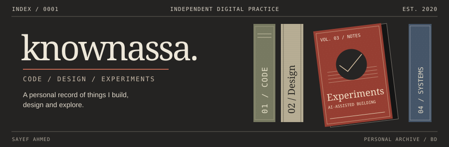
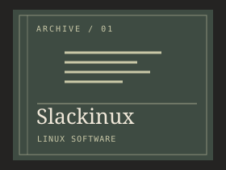
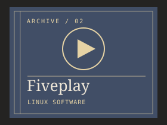
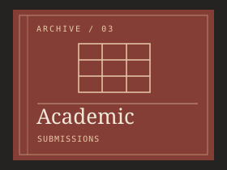

<!-- KNOWNASSA / PERSONAL INDEX -->

PERSONAL INDEX &nbsp; / &nbsp; BANGLADESH &nbsp; / &nbsp; EST. 2020

# Sayef Ahmed

**Vibe coder · Graphic designer · UI/UX designer**

I work somewhere between code and design. I use AI-assisted development to explore ideas, build software and work with technologies beyond my core programming foundations. I also design interfaces and visual identities. I enjoy making things that look considered and work well.

[Repositories](https://github.com/Knownassa?tab=repositories) &nbsp; / &nbsp; [GitHub activity](https://github.com/Knownassa?tab=overview) &nbsp; / &nbsp; [Full statistics](https://gitshine.com/stats/Knownassa)

---

01 / PRACTICE

## What I do

| Code | Design |
| :--- | :--- |
| Build web applications and experimental tools | Graphic design and visual communication |
| AI-assisted development and rapid prototyping | UI/UX and interaction design |
| Explore software systems and integrations | Interface prototyping and design systems |

02 / TOOLKIT

## What I work with

**Programming foundations** — languages I personally know.

    

**Design practice** — visual and interface work.

       

**AI-assisted build stack** — technologies I work with through experimentation and AI-assisted development; not a claim of independent mastery.

        

**Workflow & environment**

      

---

03 / SELECTED WORK

## The archive

| Index | Repository | Field |
| :--- | :--- | :--- |
| `01` | [Slackinux](https://github.com/Knownassa/Slackinux) | Linux software |
| `02` | [FIveplayonlinux](https://github.com/Knownassa/FIveplayonlinux) | Linux software |
| `03` | [knownassaAcademicsubmissions](https://github.com/Knownassa/knownassaAcademicsubmissions) | Academic work |
| `04` | [Fontsequal](https://github.com/Knownassa/Fontsequal) | Personal repository |
| `05` | [sutanote](https://github.com/Knownassa/sutanote) | Personal repository |

[Browse the complete repository index ↗](https://github.com/Knownassa?tab=repositories)

---

04 / ACTIVITY RECORD

## GitHub, in numbers

<b>Language distribution &amp; activity patterns</b>

 

Repository language distribution reflects the code in my public repositories, including AI-assisted work; it is not a measure of personal language proficiency.

05 / MILESTONES

## Earned badges

<b>Achievement progress &amp; year in review</b>

Statistics and milestone tiers are supplied by GitShine and GitHub public data. GitShine badges are third-party milestones, not an official global GitHub ranking.

---

06 / ONGOING

## Currently exploring

AI-assisted product development, full-stack applications, software systems, and the intersection of interface design and engineering.

**Find me:** [@Knownassa](https://github.com/Knownassa)

END OF INDEX &nbsp; / &nbsp; CODE · DESIGN · EXPERIMENTS
